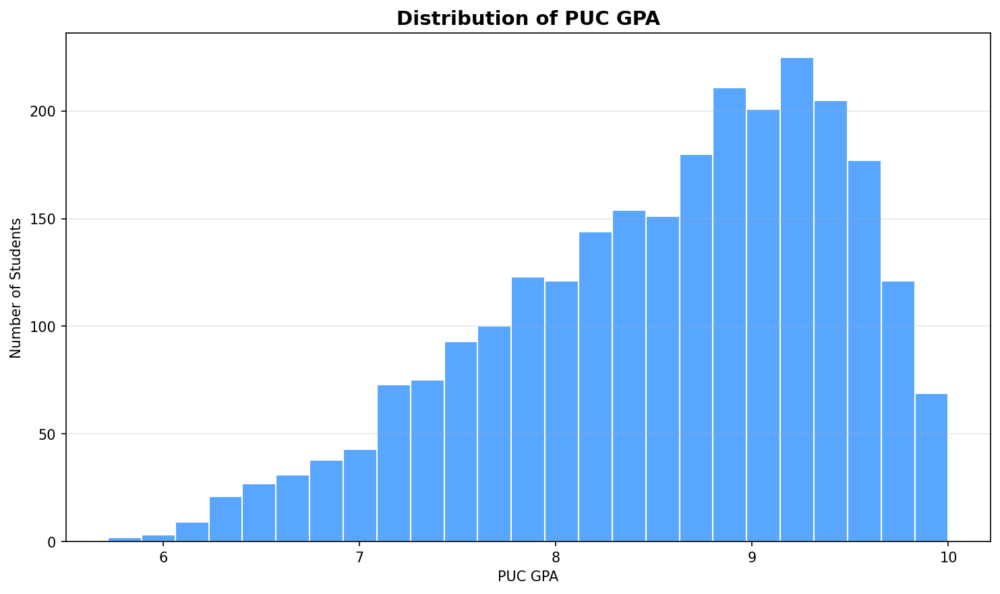
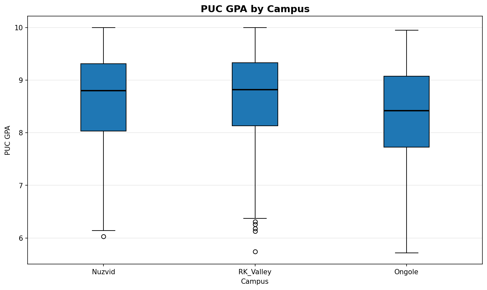
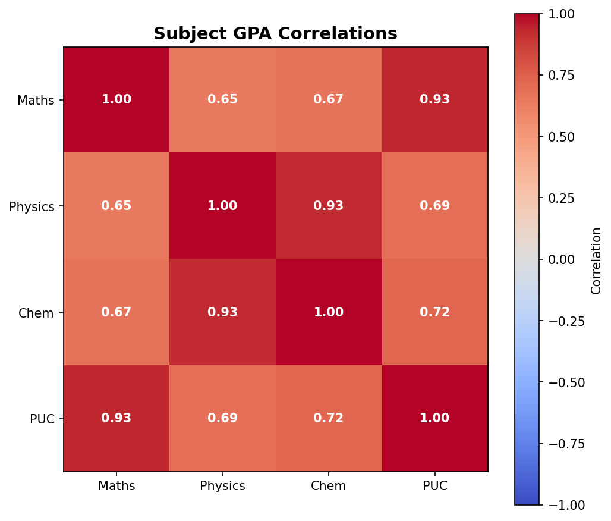
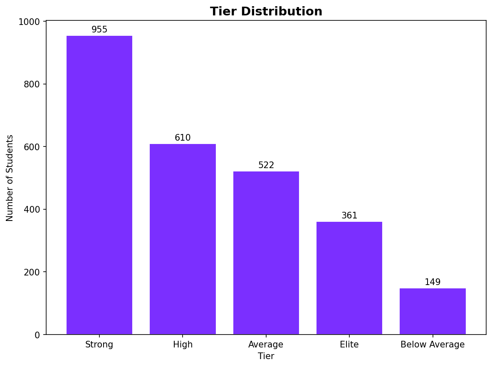

# Student Performance Analyzer

A Python tool for analysing RGUKT student performance data across campuses and batches. Load a CSV file of PUC results, and get instant answers about how the batch performed: tier classifications, campus percentiles, rank estimates, and four analytical charts.

Built during Semester 1 of B.Tech at RGUKT Nuzvid, as a follow-up to my earlier exploration of the N23 batch data. The goal was to build a small, honest data-analysis tool on real institutional data—not a machine-learning prediction, but a real descriptive analysis that produces insight people can act on.

---

## What This Project Does

Given a CSV file of student records, the tool does four core things:

1. **Loads and Validates Data:** Flags any rows where GPAs fall outside the valid 0-10 range.
2. **Classifies Performance Tiers:** Places every student into one of five performance tiers based on their overall PUC GPA.
3. **Computes Campus Percentiles:** Calculates each student's percentile rank *within their own campus*. A Nuzvid student is compared only with other Nuzvid students, ensuring a fair evaluation despite different batch sizes.
4. **Generates Insights & Estimates Ranks:** Produces four analytical charts and provides a `Rank Estimator`. By passing a campus name and a GPA, the estimator returns the historical rank, percentile, and tier that GPA would have corresponded to in the N23 batch.

> **Note:** The estimator is not a prediction tool. It reads historical data and tells you exactly where a given GPA would have landed if it had appeared in that specific batch. Honest analysis over speculative prediction is the central focus of this project.

---

## The Data

The dataset used here is the anonymised N23 batch (2023 intake) from three RGUKT campuses:

*   **Nuzvid:** 1,052 students
*   **RK Valley:** 837 students
*   **Ongole:** 708 students
*   **Total:** 2,597 students

### Schema
The CSV expects the following columns: `Campus`, `Student_ID`, `Rank`, `Maths_GPA`, `Physics_GPA`, `Chem_GPA`, `PUC_GPA`, `Gender`. 

*Student IDs are completely anonymised to protect privacy; no names or personal information are included. Srikakulam campus data was not available at the time of writing.*

The program is designed to scale dynamically. Adding a new campus or a new batch in the future is as simple as dropping a new CSV file into the `data/` folder without rewriting any core code.

---

## Charts

### 1. GPA Distribution

Shows the overall shape of the batch's performance. Most students cluster in the 8.0-9.5 range, with a smaller cluster near 10.0 (the toppers) and a thin tail below 7.0 (borderline cases).

### 2. GPA by Campus

A box plot per campus. The middle line represents the median, the box contains the middle 50% of students, and the whiskers show the full range. This provides deeper insight into performance spread than a basic bar chart of averages.

### 3. Subject Correlations

Illustrates how strongly each subject's GPA relates to the others and to the final PUC GPA. Mathematics shows the strongest correlation with the overall PUC GPA, helping students understand which subject heavily impacts their final result.

### 4. Tier Distribution

Displays how the batch splits across five distinct performance tiers: *Below Average*, *Average*, *Strong*, *High*, and *Elite*.

---

## Project Structure

```text
Student_Performance_Analyzer/
├── analyzer/
│   ├── __init__.py
│   ├── loader.py       # DataLoader: reads and validates the CSV
│   ├── stats.py        # StudentAnalyzer: calculates tiers, percentiles, rank estimation
│   └── visualizer.py   # Visualizer: generates the four analytical charts
├── data/
│   └── rgukt_23batch_branch_data.csv
├── outputs/
│   └── charts/         # Generated PNG visualizations
├── main.py             # Main entry point for execution
├── README.md
└── requirements.txt
```

---

## How to Run

Follow these steps to set up and run the analysis tool on your local machine:

```bash
# 1. Install dependencies
pip install -r requirements.txt

# 2. Run the analysis
python main.py
```

### Expected Output
When executed, the terminal will display:
*   A high-level dataset summary
*   The overall tier distribution breakdown
*   Campus-wise GPA averages
*   Four live rank-estimation examples
*   A confirmation message verifying that all four analytical charts have been saved successfully to the `outputs/charts/` directory.

## What I Learned

Building this project taught me how to work with **pandas** beyond the basics:
*   `groupby` and `rank(pct=True)`
*   `pd.cut` for binning data
*   **Boolean masking** for precise counting
*   Understanding the structural difference between an **estimate** and a **prediction**

It also forced me to think about the **ethics of working with institutional data**: what to include, what to exclude, and what to communicate in the `README` so a reader fully understands the scope and limits of the analysis.

---

## Project Context

The project is the second in my self-directed **Summer Ark 2026** series. 
1.  **First Project:** Finance Manager CLI
2.  **Second Project:** Student Performance Analyzer

Both were built to transition from *"learning Python syntax"* to *"building tools that solve a real problem."*

---

## ✍️ Author

**Guvvala Venkata Narayana**  
*B.Tech CSE, RGUKT Nuzvid*

[GitHub](https://github.com/Venkatanarayana7)  [Portfolio](https://venkatanarayana7.github.io/portfolio/) [LinkedIn](https://www.linkedin.com/in/venkata-narayana-guvvala-9a568b376/)
